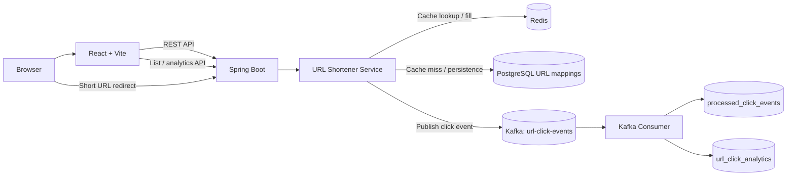

# LinkForge — URL Shortener with Redis & Kafka

LinkForge is a full-stack URL shortener built with Spring Boot, PostgreSQL, Redis, Kafka, and React. It demonstrates persistent URL mappings, cache-aside reads, asynchronous click analytics, idempotent event processing, and a paginated dashboard.

> **Current scope:** URL creation, redirects, expiry, Redis caching, Kafka click events, duplicate-event protection, paginated URL listing, per-link analytics, and the React dashboard have been implemented locally. Retry/DLT handling, authentication, rate limiting, production deployment, and load testing are future work.

## Features

- Create short URLs with generated codes or optional alphanumeric custom aliases.
- Optional expiry timestamps; omitted expiry means no expiry.
- Redirect short codes to original URLs.
- PostgreSQL persistence with Flyway migrations.
- Redis cache-aside lookups with TTL.
- Kafka-based asynchronous click analytics.
- Idempotent analytics updates using unique event IDs and `processed_click_events`.
- Paginated URL listing with click counts fetched in bulk.
- React + Vite dashboard with create, copy, expiry, and analytics UI.
- Docker Compose for local PostgreSQL, Redis, and Kafka.


## Architecture



See [`docs/architecture.md`](docs/architecture.md) for request flows and trade-offs.


## Technology stack

| Layer | Technology |
|---|---|
| Backend | Java 25, Spring Boot 4, Spring MVC |
| Data | PostgreSQL, Spring Data JPA, JDBC, Flyway |
| Cache | Redis, Spring Data Redis |
| Events | Apache Kafka, Spring for Apache Kafka |
| Frontend | React, Vite, JavaScript, CSS |
| Local infrastructure | Docker Compose |
| Tests | JUnit / Spring Boot Test |

## Prerequisites

- JDK 25 (or the Java version configured by the project)
- Docker Desktop and Docker Compose
- Node.js and npm
- Git

```powershell
java -version
docker --version
docker compose version
node --version
npm --version
```

## Run locally

### 1. Start infrastructure

From the repository root:

```powershell
docker compose up -d
docker compose ps
```

The current Compose setup exposes PostgreSQL at `localhost:5432`, Redis at `localhost:6379`, and Kafka at `localhost:9092`. The local database is named `urlshortener`, with username `appuser` and password `localdev` in the current development configuration. **These are development-only credentials; do not use them in a public deployment.**

### 2. Start Spring Boot

```powershell
.\mvnw.cmd spring-boot:run
```

If the Maven Wrapper is not present, use `mvn spring-boot:run`. The backend listens on `http://localhost:8080`; Flyway applies database migrations on startup.

### 3. Start React

Open a second terminal:

```powershell
cd frontend
npm install
npm run dev
```

Open the URL Vite prints, usually `http://localhost:5173`. The backend's local CORS configuration must allow this origin.

## API overview

| Method | Endpoint | Purpose |
|---|---|---|
| `POST` | `/api/urls` | Create a short URL |
| `GET` | `/{shortCode}` | Redirect to the original URL |
| `GET` | `/api/urls?page=0&size=10` | Paginated URL list with click counts |
| `GET` | `/api/urls/{shortCode}/analytics` | Analytics for one short code |

### Create URL example

```http
POST /api/urls
Content-Type: application/json
```

```json
{
  "originalUrl": "https://www.example.com/articles",
  "customAlias": "my-article",
  "expiresAt": "2027-01-01T00:00:00Z"
}
```

`customAlias` and `expiresAt` are optional. Omit the alias to generate a code automatically; omit expiry for a link without an expiration time.

Example response:

```json
{
  "shortCode": "my-article",
  "shortUrl": "http://localhost:8080/my-article",
  "originalUrl": "https://www.example.com/articles",
  "expiresAt": "2027-01-01T00:00:00Z"
}
```

Values are illustrative. Generated codes and timestamps depend on the request.

### List URLs

```http
GET /api/urls?page=0&size=10
```

Returns `content` plus `page`, `size`, `totalElements`, and `totalPages`. Each URL item includes `totalClicks`.

### Read analytics

```http
GET /api/urls/my-article/analytics
```

Click counts update asynchronously, so an analytics response immediately after a redirect may briefly show the previous count.

## Design notes

### Redis cache-aside
The service checks Redis first. On a cache hit, it can avoid a PostgreSQL read. On a miss, it loads the mapping from PostgreSQL and fills Redis with a TTL. The application still checks URL expiry.

### Kafka analytics
Successful redirects publish click events to Kafka. A consumer processes them asynchronously and updates the PostgreSQL aggregate, keeping analytics work out of the main redirect response path.

### Idempotency
Each event has an ID recorded in `processed_click_events`. A duplicate event ID is skipped, and the deduplication insert plus analytics increment are transactional. This protects against duplicate processing of the same event ID; it is not a blanket guarantee against every possible event-loss scenario.

### Pagination
The listing API fetches click counts for the current page in bulk rather than running a separate analytics query for every URL.

## Tests

```powershell
.\mvnw.cmd test
```

A repository test verifies that processing the same click event twice increments the count only once.

## GitHub checklist

- [ ] Run backend tests and `npm run build` in `frontend/`.
- [ ] Review `git status` and `git diff` before committing.
- [ ] Do not commit real passwords, tokens, private keys, or cloud credentials.
- [ ] Add dashboard screenshots under `docs/images/`.
- [ ] Verify setup instructions from a clean checkout.
- [ ] Add a license if you want to grant others explicit reuse rights.

## Roadmap

Potential future improvements—not claimed as implemented: Kafka retry/DLT handling, authentication, rate limiting, production secrets management, metrics, load testing, deployment, and richer aggregate analytics.

## Suggested GitHub description

Full-stack URL shortener with Spring Boot, PostgreSQL, Redis cache-aside, Kafka click analytics, and a React dashboard.

Suggested topics: `java`, `spring-boot`, `react`, `postgresql`, `redis`, `kafka`, `docker-compose`, `system-design`, `url-shortener`.
